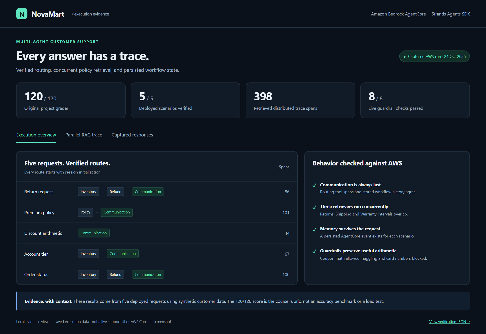
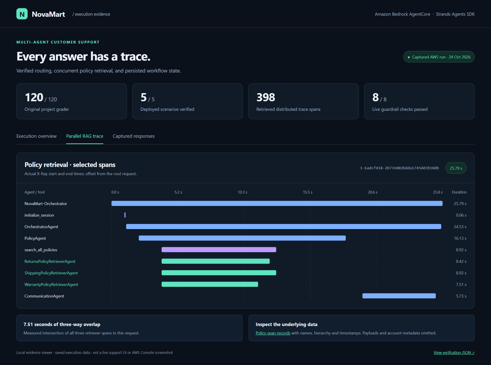
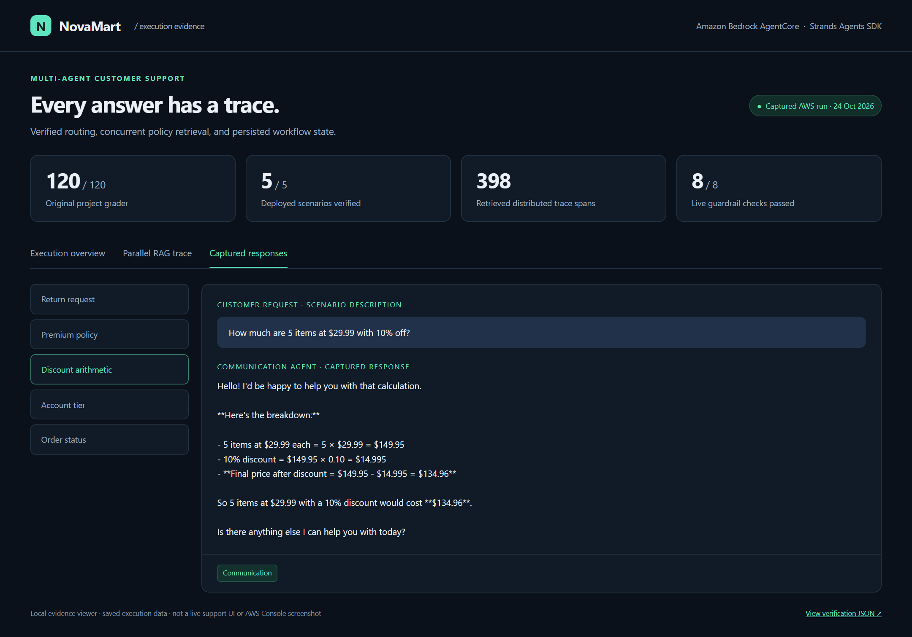
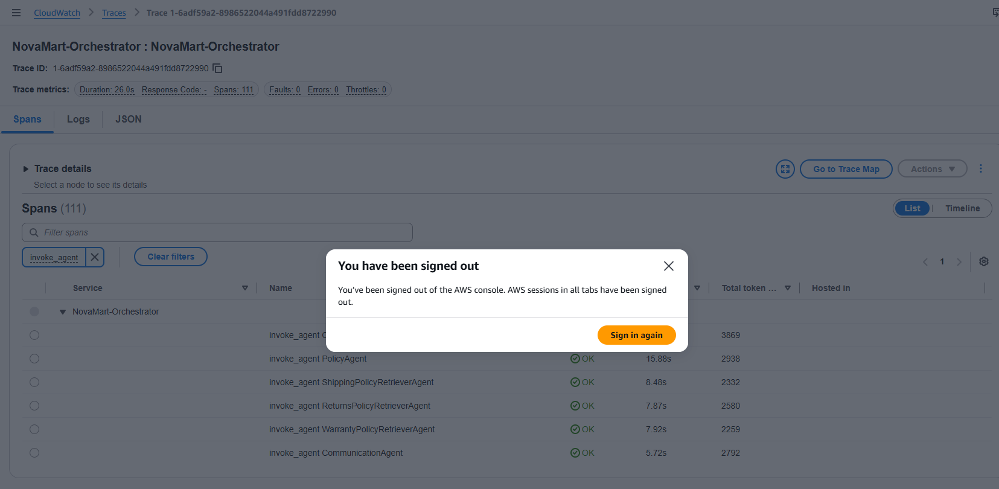
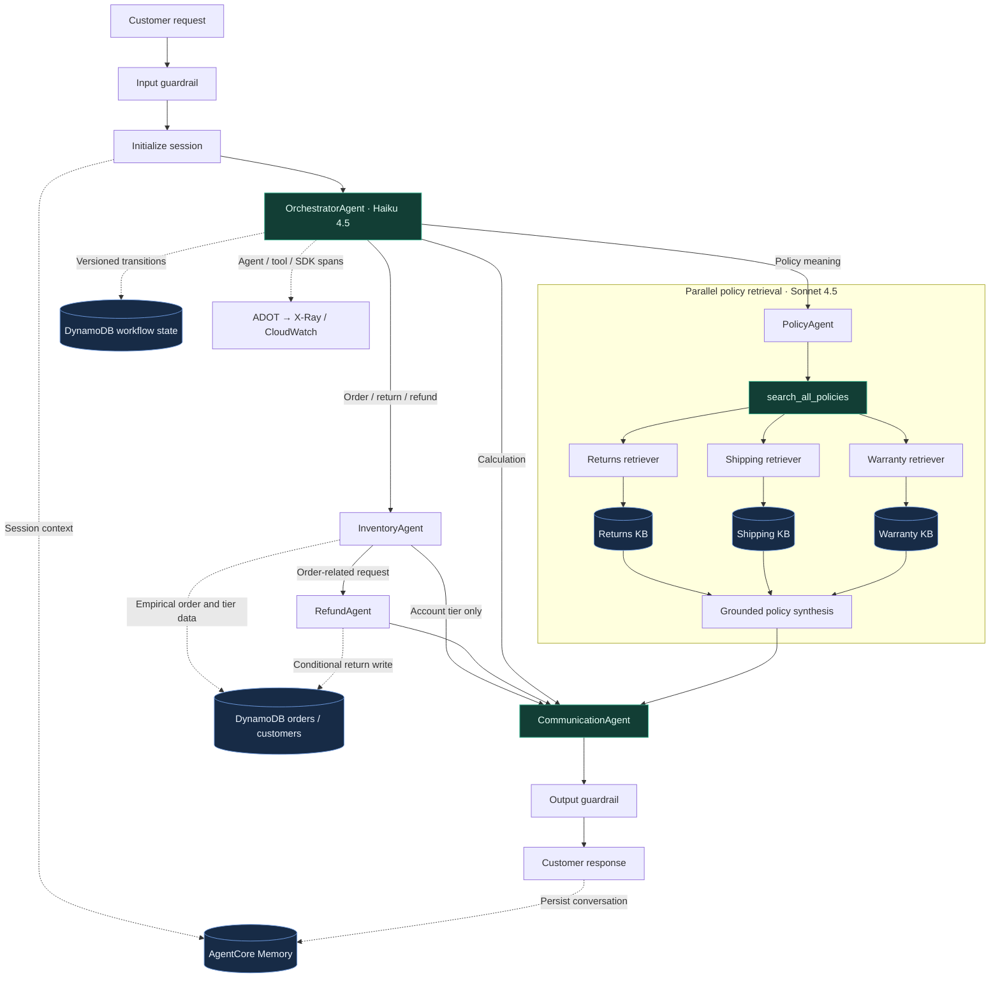

# NovaMart · Multi-Agent E-commerce RAG

**An AWS-deployed customer support system that routes requests, retrieves policy evidence, and records every agent handoff.**

[](https://github.com/ks-exe/Multi-Agent-E-commerce-RAG/actions/workflows/checks.yml)


[](docs/submission/logs/all.txt)

NovaMart handles order status, returns, account tiers, policy questions, and discount calculations through five specialized agents and three policy retrievers. The implementation combines LLM reasoning with explicit routing controls, versioned DynamoDB state, published guardrails, and distributed tracing.

**Engineering focus:** agent orchestration · parallel RAG · AWS infrastructure · workflow correctness · observability.

[Reviewer evidence](docs/submission/README.md) · [Architecture](#architecture) · [Screenshots](#screenshots-and-execution-evidence) · [Run locally](#run-locally) · [Deployment guide](docs/DEPLOYMENT.md) · [Verification data](docs/evidence/verification.json)

## Screenshots and execution evidence

**Latest AWS verification, 26 October 2026:** **120/120** on the unchanged grader,
**5/5** deployed workflows verified, and **433** trace spans. The
[resubmission evidence index](docs/submission/README.md) includes all individual
task screenshots, AWS deployment and KB sync screens, end-to-end output, and the
requested [deployment .env](.env) containing resource identifiers only.

The screenshots below show the repository's **local evidence viewer**, rendered from a deployed AWS run on **24 October 2026**. They display saved execution data, not a live customer application or the AWS Console. After cloning, open [`docs/index.html`](docs/index.html) in a browser to explore the scenarios and responses without AWS credentials.



| Verification | Recorded result | Evidence |
| --- | --- | --- |
| Original course grader | **120/120 points**; grader unchanged | [Full output](docs/evidence/grader-output.txt) |
| Deployed scenarios | **5/5** routes verified against stored workflow state | [Scenario results](docs/evidence/verification.json) |
| Distributed tracing | **398 spans** across the five requests | [Span counts and trace IDs](docs/evidence/verification.json) |
| Parallel policy RAG | Three retrievers overlap for **7.51 seconds** in the captured policy request | [Span timestamps](docs/evidence/policy-trace.json) |
| Guardrails | **8/8** live checks passed | [Guardrail results](docs/evidence/guardrail-results.json) |
| Workflow behavior | **9** offline tests; also run in CI | [Behavioral tests](tests/test_workflow.py) |
| Knowledge Bases | Six source documents indexed across three domains; zero document failures | [Ingestion results](docs/evidence/knowledge-bases.json) |

These are reproducible functional checks using synthetic customer data. The rubric score is not a retrieval-accuracy benchmark, and the five requests are not a load test.

### Parallel retrieval, visible in the trace

`search_all_policies` invokes the Returns, Shipping, and Warranty retriever agents through `ThreadPoolExecutor(max_workers=3)` and collects results with `as_completed()`. The screenshot uses actual span timestamps and shows selected agent/tool spans from the 101-span policy trace.



<details>
<summary><strong>View a captured customer response</strong></summary>



The evidence viewer includes all five saved responses. The discount example correctly returns **$134.96** for five items at $29.99 with 10% off. A policy-only question describes Premium benefits conditionally; it does not assume the customer's tier.

</details>

### Captured in the AWS Console

The current policy trace shows **NovaMart-Orchestrator connected to PolicyAgent,
CommunicationAgent, and the three named policy retrievers**. It contains **111
spans** with zero faults, errors, or throttles. The screenshot below comes
directly from CloudWatch's X-Ray Trace details, captured on **26 October 2026**.


X-Ray infers these logical dependency nodes from spans around actual agent
invocations. The agents execute inside one AgentCore Runtime; the graph's
`remote` classification does not imply separate worker deployments. Native
Strands spans preserve the detailed model calls, tool calls, and concurrent
retrieval timings.

<details>
<summary><strong>Inspect the six named agent spans</strong></summary>



</details>

Trace: [`1-6adf59a2-8986522044a491fdd8722990`](https://us-east-1.console.aws.amazon.com/xray/home?region=us-east-1#/traces/1-6adf59a2-8986522044a491fdd8722990)
(AWS sign-in required). See the [complete evidence and capture instructions](docs/submission/README.md).

## Architecture



The graph runs in **Amazon Bedrock AgentCore Runtime**, using the **Strands Agents SDK**. The three Knowledge Bases use **S3 Vectors** with **Titan Text Embeddings v2**, 1,024-dimensional cosine indexes, and separate returns, shipping, and warranty document prefixes.

### Agent responsibilities

Model IDs are centralized in [`config.py`](config.py); agent builders reference those constants.

| Agent | Responsibility | Model | Temperature |
| --- | --- | --- | --- |
| Orchestrator | Initialize, route, and enforce terminal handoff | Claude Haiku 4.5 | 0.0 |
| Inventory | Retrieve authoritative order and customer facts | Claude Sonnet 4.5 | 0.1 |
| Refund | Validate the 30-day Standard / 60-day Premium window and record eligible returns | Claude Sonnet 4.5 | 0.1 |
| Policy coordinator | Synthesize grounded policy passages | Claude Sonnet 4.5 | 0.2 |
| Three policy retrievers | Independently retrieve and summarize each policy domain | Claude Sonnet 4.5 | 0.0 |
| Communication | Produce the final customer-facing response | Claude Sonnet 4.5 | 0.3 |

## Engineering decisions

- **Routing is enforced in code as well as prompts.** Every request initializes state first. Order requests run Inventory before Refund; tier queries use Inventory; calculations go straight to Communication. The terminal handoff prevents later router output or tool calls from becoming the customer answer.
- **Facts and decisions have separate owners.** Inventory extracts data. Refund checks authoritative order dates, delivery status, customer ownership, and tier before a conditional write. A repeated return preserves its existing reference.
- **State updates detect conflicting writes.** Each routing tool reads the current workflow and updates it with `expected_version=state["version"]`. Session and customer bindings constrain worker access.
- **Policy retrieval runs concurrently.** Three separate retriever agents search independent KBs before synthesis. Evidence timestamps verify real overlap; no unmeasured speedup claim is made.
- **Guardrails preserve valid use cases.** Published input/output policies block card and SSN data, anonymize email and phone, and deny competitor, haggling, and legal-threat topics. Mathematical coupon calculations remain allowed.
- **Trace delivery is verified after deployment.** ADOT exports agent, tool, and AWS SDK spans with 100% application sampling. Verification retrieves the trace documents and compares them with DynamoDB history and persisted memory events.

The most useful entry points for code review are [`src/agent_orchestrator.py`](src/agent_orchestrator.py), [`tests/test_workflow.py`](tests/test_workflow.py), and [`infrastructure/capture_traces.py`](infrastructure/capture_traces.py).

## Run locally

Requires **Python 3.13**. AWS credentials are unnecessary for the evidence viewer and offline behavioral tests.

```bash
git clone https://github.com/ks-exe/Multi-Agent-E-commerce-RAG.git
cd Multi-Agent-E-commerce-RAG
python -m venv .venv
```

Activate the environment:

| Shell | Command |
| --- | --- |
| PowerShell | `.\.venv\Scripts\Activate.ps1` |
| macOS / Linux | `source .venv/bin/activate` |

```bash
python -m pip install -r requirements.txt
python tests/test_workflow.py
python tools/build_portfolio.py
```

Open `docs/index.html` locally to inspect the saved evidence. To deploy your own system, follow the [AWS deployment guide](docs/DEPLOYMENT.md), which covers credentials, model access, infrastructure, KB ingestion, runtime deployment, and trace storage.

After deployment:

```bash
python tests/test_agent.py all
python tests/test_live_guardrail.py
python src/agent_orchestrator.py test
```

The deployed test command exercises the five scenarios, including a return against seeded demo orders. AWS calls incur usage charges.

## Repository map

```text
src/
  agent_orchestrator.py       Agent builders, routing, guardrails, deployment
  agentcore_cli.py            Current AgentCore API deployment adapter
  runtime_http.py            Runtime entry point and request tracing
  session_context.py         Input/output guardrails and conversation memory
  telemetry.py               ADOT exporters and correlated logging
  runtime_support.py         Runtime configuration and observability setup
  bedrock_kb_retrieval.py     Bedrock Knowledge Base retrieval
infrastructure/
  starter_stack.yaml         DynamoDB, S3, S3 Vectors, IAM and logging resources
  deploy_stack.py            CloudFormation validation and deployment
  seed_data.py               Synthetic customers, orders and policy documents
  setup_knowledge_bases.py    KB creation, ingestion and retrieval verification
  configure_trace_storage.py Regional X-Ray storage configuration
  capture_traces.py          Trace, routing, memory and concurrency verification
tests/                       Original grader, behavioral and live guardrail tests
docs/                        Deployment guide, evidence, screenshots and viewer
tools/                       Reproducible evidence export and browser capture
config.py                    Central model and resource configuration
aws_compat.py                Legacy grader compatibility with current AWS APIs
```

## Scope and practical limits

This is a deployed capstone and portfolio implementation. A customer application still needs authentication that derives `customer_id` from the signed-in user; the demonstration accepts it under IAM-authorized runtime access. Return handling records a workflow operation in DynamoDB and does not connect to a payment processor. Load testing, broader retrieval evaluation, and service-level latency targets remain future work.

`src/agentcore_cli.py` is a project adapter over current AgentCore control APIs. `aws_compat.py` maps the original grader's legacy read methods to actual AWS resource configuration; it does not fabricate results. The grader's older Claude 3 display labels are retained, while the configured and live-verified models are Claude 4.5.

The **AWS Console trace graph and named agent spans** are included above for course submission, alongside the separate portfolio viewer screenshots. See the [submission checklist](docs/SUBMISSION.md).

## Attribution

Completed from the Udacity AWS Agentic AI course starter. The original grader and upstream license are preserved; see [NOTICE.md](NOTICE.md) and [LICENSE.md](LICENSE.md). The supplied [architecture plan](docs/NovaMart_MultiAgent_Architecture_Plan.docx) is retained for reference.

**Author:** [Khadija Sajid · ks-exe](https://github.com/ks-exe)
