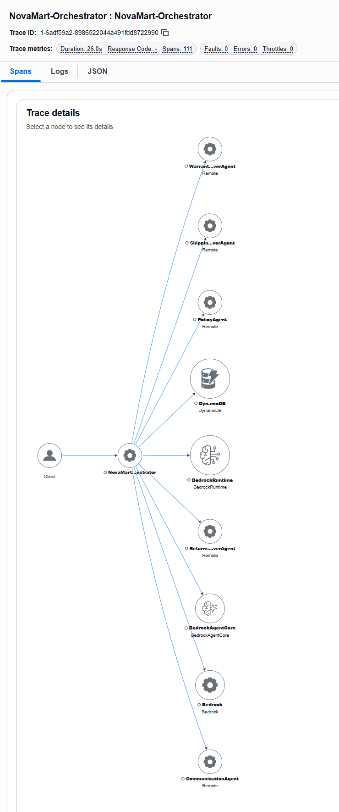

# NovaMart resubmission evidence

Verified on **26 October 2026 (UTC)** in **us-east-1**. The unchanged classroom grader passes **120/120**. Runtime **version 6** is READY with PUBLIC networking and HTTP. All three Knowledge Bases were synced successfully. Five deployed requests were checked against DynamoDB state, AgentCore memory, and X-Ray.

## Reviewer checklist

| Requested evidence | Screenshot | Complete output / configuration |
| --- | --- | --- |
| Task 2 passes | [40/40](images/task2.png) | [Execution log](logs/task2.txt) |
| Task 3 passes | [20/20](images/task3.png) | [Execution log](logs/task3.txt) |
| Task 4 passes | [15/15](images/task4.png) | [Execution log](logs/task4.txt) |
| Task 5 passes | [25/25](images/task5.png) | [Execution log](logs/task5.txt) |
| Task 6 passes | [20/20](images/task6.png) | [Execution log](logs/task6.txt) |
| Full original grader | [120/120](images/all.png) | [Execution log](logs/all.txt) |
| Complete runtime deployment | [AWS Console](images/agentcore-runtime.png), [deployment command](images/deploy.png) | [Deployment log](logs/deploy.txt), [live API metadata](deployment.json) |
| Runtime environment and guardrail | [AWS Console configuration](images/agentcore-configuration.png) | [Root .env](../../.env), [live API metadata](deployment.json) |
| AgentCore Memory | [AWS Console](images/agentcore-memory.png) | [Strategy and seven-day retention](deployment.json) |
| Returns KB | [Overview / Titan v2](images/kb-returns.png), [completed sync](images/kb-returns-sync.png), [S3 vector index](images/vector-returns.png) | [Actual KB-to-index mapping](deployment.json) |
| Shipping KB | [Overview / Titan v2](images/kb-shipping.png), [completed sync](images/kb-shipping-sync.png), [S3 vector index](images/vector-shipping.png) | [Actual KB-to-index mapping](deployment.json) |
| Warranty KB | [Overview / Titan v2](images/kb-warranty.png), [completed sync](images/kb-warranty-sync.png), [S3 vector index](images/vector-warranty.png) | [Actual KB-to-index mapping](deployment.json) |
| Correct shared vector bucket | [All three indexes in S3](images/s3-vector-indexes.png) | [Verified infrastructure output](logs/infrastructure.txt) |
| Real parallel retrieval from all KBs | [Passing checks](images/parallel-summary.png), [full output](images/parallel.png) | [Execution log](logs/parallel.txt) |
| `python src/agent_orchestrator.py test` | [Five responses and trace IDs](images/live.png) | [Execution log](logs/live.txt), [verified routes and memory](live-verification.json) |
| X-Ray service map with worker nodes | [Actual AWS Console graph](images/xray-service-map.png) | [Actual X-Ray graph API response](service-map.json) |
| Named agent spans | [AWS Console span list](images/xray-agent-spans.png) | [Span names and overlapping intervals](live-verification.json) |
| Deployed `.env` identifiers | [Root .env](../../.env) | [Matching runtime environment from AWS](deployment.json) |

## Deployed configuration

| Domain | Knowledge Base | S3 prefix | Index |
| --- | --- | --- | --- |
| Returns | `XZ38YZEVM9` | `policies/returns/` | `returns-policy-index` |
| Shipping | `NOUBGNAIZF` | `policies/shipping/` | `shipping-policy-index` |
| Warranty | `DDSNJMEKAF` | `policies/warranty/` | `warranty-policy-index` |

All indexes belong to `udacity-agentcore-vectors-731451715213-0eadcb60`, use 1,024-dimensional vectors and cosine distance, and support `amazon.titan-embed-text-v2:0`. Each latest ingestion scanned two documents, finished COMPLETE, and reported zero failures. Unchanged documents were already indexed; the original successful ingestion also remains visible in Sync history.

The root `.env` is deliberately included at the project owner's request. It contains resource identifiers, region, and a numbered guardrail version, with no access keys, secret keys, session tokens, or console sign-in credentials.

Memory has **seven-day event retention**. The summarization strategy is active;
the Console separately shows that generated long-term summary records do not expire.

## End-to-end trace

Policy trace: [`1-6adf59a2-8986522044a491fdd8722990`](https://us-east-1.console.aws.amazon.com/xray/home?region=us-east-1#/traces/1-6adf59a2-8986522044a491fdd8722990) (AWS sign-in required).

The five requests contain **433 spans**. The policy request contains **111**, including the orchestrator, PolicyAgent, CommunicationAgent, three policy retrievers, their retrieval tools, and AWS SDK calls. The three retriever intervals overlap for **7.87 seconds**. Every workflow has the required route order and a stored memory event.



This is the **per-request service graph** in CloudWatch's X-Ray Trace details. Actual agent invocations emit dependency spans with `peer.service` names, allowing X-Ray to infer worker nodes. These are logical dependencies: the Strands agents run inside one AgentCore Runtime, and spans explicitly record `novamart.agent.execution=in_process`. X-Ray's `remote` classification does not imply separate worker deployments. Native Strands spans retain their real parent relationships and concurrent retrieval timings.

## Evidence provenance and console notes

- AWS screenshots come from a temporary read-only Console session. Navigation bars and unused space were cropped. No resource values, statuses, or graph data were edited.
- Execution screenshots are clearly labeled **screenshots of recorded stdout and stderr**, rendered from the actual command transcripts. Each log has JSON metadata with its command, UTC timestamps, Python version, exit code, and SHA-256 checksum. The parallel summary is labeled as an excerpt; complete output is also included.
- The Bedrock Console leaves **S3 vector index** blank for KBs created with the supported `vectorBucketArn` + `indexName` configuration. AWS rejects changes to an existing KB's storage configuration, even to an equivalent index ARN. The paired S3 Console screenshots, actual `storageConfiguration` in [deployment.json](deployment.json), and [verification output](logs/infrastructure.txt) prove each connection without recreating working KBs. New KBs created by the setup script use `indexArn` for console compatibility.
- The read-only capture session cannot open KB ingestion log-delivery details; that optional notification was dismissed before capturing Sync history. Actual COMPLETE statuses and indexed documents remain visible. Runtime logging and trace delivery were verified separately against AWS.
- The unchanged starter grader prints legacy **Claude 3** labels. Its checks use configuration constants. Actual model IDs remain **Haiku 4.5** for the orchestrator and **Sonnet 4.5** for workers. The runtime uses **HTTP**, as required by the rubric.

## Reproduce

Check the supplied snapshot offline with `python tools/verify_submission.py`.
To generate new execution evidence, activate the Python environment and
authenticate the AWS CLI in the deployment account. From the repository root:

```powershell
python tools/run_evidence.py task2 task3 task4 task5 task6 all
python tools/run_evidence.py infrastructure parallel live
python infrastructure/capture_traces.py --scenario-log docs/submission/logs/live.txt
node tools/capture_execution_logs.mjs
```

Live tests invoke Bedrock models and generate new trace IDs and timings. Review
and replace the corresponding trace metadata and AWS screenshots together when
publishing a newer snapshot. See the [deployment guide](../DEPLOYMENT.md) for
deployment and sync commands.

For manual screenshots, select **us-east-1**. Open **Bedrock → Knowledge Bases** and each KB's overview and data source Sync history. Open **S3 → Vector buckets** for index properties. Open **AgentCore → Agents** for runtime details and **Memory** for its strategy. Follow the printed policy trace URL, expand **Trace details**, and use **Full screen** for the graph. Filter the span list by `invoke_agent` to show all six policy-route agents. Use **Win + Shift + S** to capture the relevant area.

Submit the repository URL, or download its ZIP if the classroom asks for an upload. Both include this evidence folder and the root `.env`:

https://github.com/ks-exe/Multi-Agent-E-commerce-RAG
